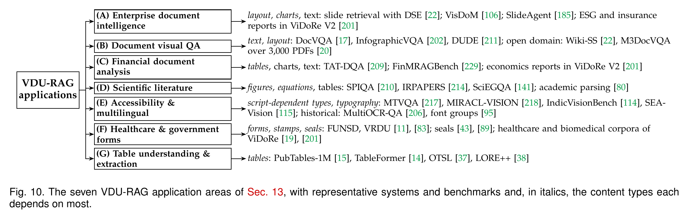

# Application domains (paper Fig. 10 and Sec. 13)

[Paper Fig. 10 (HD)](figures_tables.md#fig-10) · [Back to README](../README.md#paper-to-repository-map)

Where retrieval does pay off, the application decides which content types matter most. The seven areas below differ mainly in the content types they depend on (Fig. 10).

|Area|Content types it depends on most (in italics) and representative systems and benchmarks|
|---|---|
|**(A) Enterprise document intelligence**|*layout, charts*, text: slide retrieval with DSE [[22]](https://arxiv.org/abs/2406.11251); VisDoM [[106]](https://arxiv.org/abs/2412.10704); SlideAgent [[185]](https://doi.org/10.18653/v1/2026.acl-long.677); ESG and insurance reports in ViDoRe V2 [[201]](https://arxiv.org/abs/2505.17166)|
|**(B) Document visual QA**|*text, layout*: DocVQA [[17]](https://doi.org/10.1109/WACV48630.2021.00225), InfographicVQA [[202]](https://arxiv.org/abs/2104.12756), DUDE [[211]](https://doi.org/10.1109/iccv51070.2023.01789); open domain: Wiki-SS [[22]](https://arxiv.org/abs/2406.11251), M3DocVQA over 3,000 PDFs [[20]](https://openaccess.thecvf.com/content/ICCV2025W/Findings/html/Cho_M3DocVQA_Multi-modal_Multi-page_Multi-document_Understanding_ICCVW_2025_paper.html)|
|**(C) Financial document analysis**|*tables*, charts, text: TAT-DQA [[209]](https://arxiv.org/abs/2207.11871); FinMRAGBench [[229]](https://aclanthology.org/2026.findings-acl.187/); economics reports in ViDoRe V2 [[201]](https://arxiv.org/abs/2505.17166)|
|**(D) Scientific literature**|*figures, equations*, tables: SPIQA [[210]](https://arxiv.org/abs/2407.09413), IRPAPERS [[214]](https://arxiv.org/abs/2602.17687), SciEGQA [[141]](https://yuwenhan07.github.io/SciEGQA-project/); academic parsing [[80]](https://arxiv.org/abs/2308.13418)|
|**(E) Accessibility & multilingual**|*script-dependent types, typography*: MTVQA [[217]](https://aclanthology.org/2025.findings-acl.404/), MIRACL-VISION [[218]](https://arxiv.org/abs/2505.11651), IndicVisionBench [[114]](https://openreview.net/forum?id=LmJoLn04iL), SEA-Vision [[115]](https://openaccess.thecvf.com/content/CVPR2026/html/Yue_SEA-Vision_A_Multilingual_Benchmark_for_Comprehensive_Document_and_Scene_Text_CVPR_2026_paper.html); historical: MultiOCR-QA [[206]](https://doi.org/10.1145/3746252.3761295), font groups [[95]](https://doi.org/10.1007/978-3-030-86337-1_41)|
|**(F) Healthcare & government forms**|*forms, stamps, seals*: FUNSD, VRDU [[11]](https://arxiv.org/abs/1905.13538), [[83]](https://doi.org/10.1145/3580305.3599929); seals [[43]](https://arxiv.org/pdf/2304.11966), [[89]](https://doi.org/10.1007/s10032-026-00595-5); healthcare and biomedical corpora of ViDoRe [[19]](https://openreview.net/forum?id=ogjBpZ8uSi), [[201]](https://arxiv.org/abs/2505.17166)|
|**(G) Table understanding & extraction**|*tables*: PubTables-1M [[15]](https://arxiv.org/abs/2110.00061), TableFormer [[14]](https://arxiv.org/abs/2203.01017), OTSL [[37]](https://arxiv.org/abs/2305.03393), LORE++ [[38]](https://doi.org/10.1016/j.patcog.2024.110816)|

## Enterprise Document Intelligence

For archives of contracts, reports and slides, page-image retrieval indexes about 18 times faster than a parsing pipeline (Fig. 8) and handles slide decks natively [[22]](https://arxiv.org/abs/2406.11251), [[106]](https://arxiv.org/abs/2412.10704), [[185]](https://doi.org/10.18653/v1/2026.acl-long.677).

## Document Visual Question Answering

DocVQA [[17]](https://doi.org/10.1109/WACV48630.2021.00225) is the archetypal task, since extended to infographics [[202]](https://arxiv.org/abs/2104.12756) and multi-page documents [[211]](https://doi.org/10.1109/iccv51070.2023.01789); in open domains, finding the relevant pages matters as much as reading them [[22]](https://arxiv.org/abs/2406.11251), [[20]](https://openaccess.thecvf.com/content/ICCV2025W/Findings/html/Cho_M3DocVQA_Multi-modal_Multi-page_Multi-document_Understanding_ICCVW_2025_paper.html).

## Financial Document Analysis

Financial reports mix tables, charts and prose, and questions often need arithmetic over cells [[209]](https://arxiv.org/abs/2207.11871); multimodal RAG for finance has a dedicated benchmark [[229]](https://aclanthology.org/2026.findings-acl.187/), and economics reports form part of ViDoRe V2 [[201]](https://arxiv.org/abs/2505.17166).

## Scientific Literature Understanding

Papers mix multi-column text, equations, figures and tables; benchmarks ask about figures in context [[210]](https://arxiv.org/abs/2407.09413), retrieve from paper collections [[214]](https://arxiv.org/abs/2602.17687) and ground answers in regions [[141]](https://yuwenhan07.github.io/SciEGQA-project/), while academic parsers turn pages into markup [[80]](https://arxiv.org/abs/2308.13418). Equations remain the reachable but untested cell of Table 7.

## Accessibility and Multilingual Documents

Visual retrieval sidesteps weak recognizers, although its training data are mostly Latin and Chinese (Sec. 10); benchmarks now cover many more scripts [[217]](https://aclanthology.org/2025.findings-acl.404/), [[218]](https://arxiv.org/abs/2505.11651), [[114]](https://openreview.net/forum?id=LmJoLn04iL), [[115]](https://openaccess.thecvf.com/content/CVPR2026/html/Yue_SEA-Vision_A_Multilingual_Benchmark_for_Comprehensive_Document_and_Scene_Text_CVPR_2026_paper.html), while historical documents add degraded print and period typography [[206]](https://doi.org/10.1145/3746252.3761295), [[95]](https://doi.org/10.1007/978-3-030-86337-1_41).

## Healthcare Records and Government Forms

Clinical notes and government forms are often scans with handwriting and seals; form understanding has mature benchmarks [[11]](https://arxiv.org/abs/1905.13538), [[83]](https://doi.org/10.1145/3580305.3599929), and healthcare and biomedical corpora appear in ViDoRe [[19]](https://openreview.net/forum?id=ogjBpZ8uSi), [[201]](https://arxiv.org/abs/2505.17166). Here provenance is a requirement, yet the seal that validates a form is annotated only in resources built for reading and detection [[43]](https://arxiv.org/pdf/2304.11966), [[89]](https://doi.org/10.1007/s10032-026-00595-5), not for retrieval.

## Table Understanding and Data Extraction

Tables are among the hardest elements for OCR, which linearizes their grid (Fig. 9b); structure recognition recovers cells and headers from page images [[15]](https://arxiv.org/abs/2110.00061), [[14]](https://arxiv.org/abs/2203.01017), [[37]](https://arxiv.org/abs/2305.03393), [[38]](https://doi.org/10.1016/j.patcog.2024.110816) as a module for visual RAG.

[Back to README](../README.md#paper-to-repository-map)
