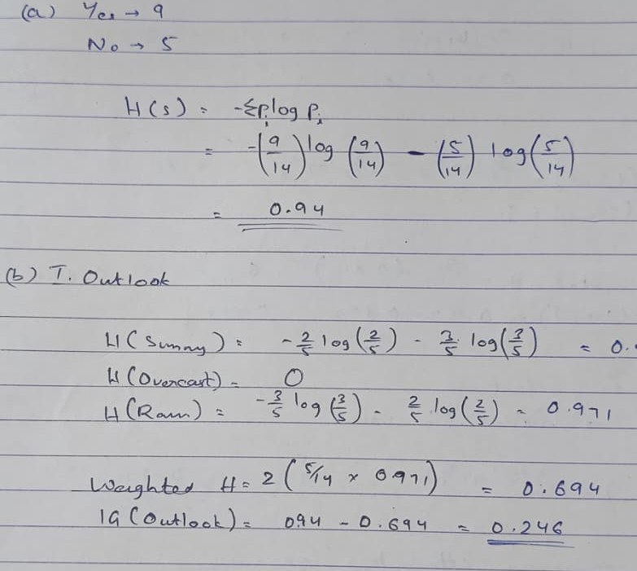

# Equations

[← Figures and charts](figures-and-charts.md) · [All content types](../../README.md#content-types) · [Form fields →](form-fields.md)

*Example region for equations, as shown around the hub in paper Fig. 2.* Equations is one of the six **content elements** (each occupies a region of the page) in the survey's content-type grouping (paper Sec. 2.2).

## Description (paper Sec. 2.2, word for word)

**Equations** carry meaning in nesting and operator scope. Surveys span a quarter century [[28]](https://doi.org/10.1007/PL00013549), [[51]](https://doi.org/10.1561/1500000095), retrieval developed under shared tasks [[76]](https://ir.webis.de/anthology/2013.ntcir_conference-2013.55), [[77]](https://ir.webis.de/anthology/2016.ntcir_conference-2016.52/), [[78]](https://doi.org/10.1145/2911451.2911512), handwritten recognition advanced through coverage- and counting-aware attention [[41]](https://arxiv.org/abs/2207.04410), [[42]](https://arxiv.org/abs/2207.11463), and printed expressions moved to large end-to-end models [[79]](https://openaccess.thecvf.com/content/CVPR2026/html/Gu_UniMERNet_A_Universal_Network_for_Real-World_Mathematical_Expression_Recognition_CVPR_2026_paper.html), [[80]](https://arxiv.org/abs/2308.13418).

## Coverage in the content-type × paradigm matrix (paper Table 7)

|OCR → LLM|MLLM-native|Text RAG|Visual RAG|
|:-:|:-:|:-:|:-:|
|✓|✓|✓|○|

✓ results reported; ○ the type has an established task but no method in that column reports on it; ✗ nothing reported.

## Benchmarks of paper Table 9 that annotate it

- [DocLayNet](https://doi.org/10.1145/3534678.3539043) (KDD 2022) · [link](https://github.com/DS4SD/DocLayNet)
- [UniMER](https://openaccess.thecvf.com/content/CVPR2026/html/Gu_UniMERNet_A_Universal_Network_for_Real-World_Mathematical_Expression_Recognition_CVPR_2026_paper.html) (CVPR 2026) · [link](https://github.com/opendatalab/UniMERNet)

## Benchmarks of paper Table 9 where it is present but not annotated

- [ViDoRe V1](https://openreview.net/forum?id=ogjBpZ8uSi) (ICLR 2025)
- [ViDoRe V2](https://arxiv.org/abs/2505.17166) (arXiv 2025)
- [ViDoRe V3](https://aclanthology.org/2026.acl-long.755/) (ACL 2026)
- [MMDocIR](https://aclanthology.org/2025.emnlp-main.1576/) (EMNLP 2025)
- [MMDocRAG](https://papers.nips.cc/paper_files/paper/2025/hash/1a93178950e92fd2e7b7448f7d68fd7d-Abstract-Datasets_and_Benchmarks_Track.html) (NeurIPS 2025)
- [M3DocVQA](https://openaccess.thecvf.com/content/ICCV2025W/Findings/html/Cho_M3DocVQA_Multi-modal_Multi-page_Multi-document_Understanding_ICCVW_2025_paper.html) (ICCVW 2025)
- [ViDoSeek](https://aclanthology.org/2025.emnlp-main.464/) (EMNLP 2025)
- [UniDoc-Bench](https://arxiv.org/abs/2510.03663) (arXiv 2025)
- [SciEGQA](https://yuwenhan07.github.io/SciEGQA-project/) (arXiv 2026)
- [SPIQA](https://arxiv.org/abs/2407.09413) (NeurIPS 2024)
- [LongDocURL](https://aclanthology.org/2025.acl-long.57/) (ACL 2025)

## Works the paper cites for it

|No.|Paper|Venue|Year|
|--:|---|---|:-:|
|[28]|[Mathematical Expression Recognition: A Survey](https://doi.org/10.1007/PL00013549)|Int. J. Doc. Anal. Recognit.|2000|
|[51]|[Mathematical Information Retrieval: Search and Question Answering](https://doi.org/10.1561/1500000095)|Found. Trends Inf. Retr.|2025|
|[76]|[NTCIR-10 Math Pilot Task Overview](https://ir.webis.de/anthology/2013.ntcir_conference-2013.55)|Proc. NTCIR-10|2013|
|[77]|[NTCIR-12 MathIR Task Overview](https://ir.webis.de/anthology/2016.ntcir_conference-2016.52/)|Proc. NTCIR-12|2016|
|[78]|[Multi-Stage Math Formula Search: Using Appearance-Based Similarity Metrics at Scale](https://doi.org/10.1145/2911451.2911512)|Proc. SIGIR|2016|
|[41]|[CoMER: Modeling Coverage for Transformer-Based Handwritten Mathematical Expression Recognition](https://arxiv.org/abs/2207.04410)|Proc. ECCV|2022|
|[42]|[When Counting Meets HMER: Counting-Aware Network for Handwritten Mathematical Expression Recognition](https://arxiv.org/abs/2207.11463)|Proc. ECCV|2022|
|[79]|[UniMERNet: A Universal Network for Real-World Mathematical Expression Recognition](https://openaccess.thecvf.com/content/CVPR2026/html/Gu_UniMERNet_A_Universal_Network_for_Real-World_Mathematical_Expression_Recognition_CVPR_2026_paper.html)|Proc. CVPR|2026|
|[80]|[Nougat: Neural Optical Understanding for Academic Documents](https://arxiv.org/abs/2308.13418)|Proc. ICLR|2024|

[Back to README](../../README.md#content-types)
