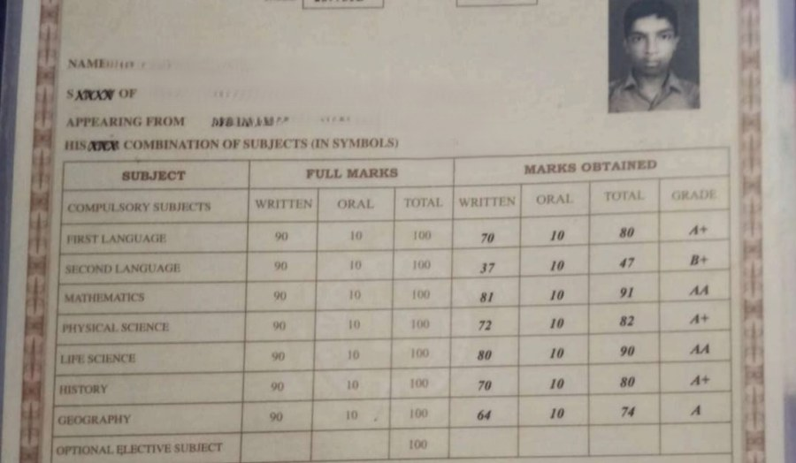

# Figures and charts

[← Tables](tables.md) · [All content types](../../README.md#content-types) · [Equations →](equations.md)

*Example region for figures and charts, as shown around the hub in paper Fig. 2.* Figures and charts is one of the six **content elements** (each occupies a region of the page) in the survey's content-type grouping (paper Sec. 2.2).

## Description (paper Sec. 2.2, word for word)

**Figures and charts** encode quantity and mean nothing until read against an axis. Data extraction was surveyed in this journal [[49]](https://doi.org/10.1109/TPAMI.2020.2992028); question answering grew from benchmarks [[73]](https://arxiv.org/abs/1909.00997), [[40]](https://arxiv.org/abs/2203.10244) to realistic charts [[74]](https://doi.org/10.52202/079017-3609) and structural extraction [[75]](https://arxiv.org/abs/2404.09987).

## Coverage in the content-type × paradigm matrix (paper Table 7)

|OCR → LLM|MLLM-native|Text RAG|Visual RAG|
|:-:|:-:|:-:|:-:|
|✓|✓|✓|✓|

✓ results reported; ○ the type has an established task but no method in that column reports on it; ✗ nothing reported.

## Benchmarks of paper Table 9 that annotate it

- [ViDoRe V3](https://aclanthology.org/2026.acl-long.755/) (ACL 2026) · [link](https://arxiv.org/pdf/2601.08620)
- [MMDocIR](https://aclanthology.org/2025.emnlp-main.1576/) (EMNLP 2025) · [link](https://huggingface.co/MMDocIR)
- [MMDocRAG](https://papers.nips.cc/paper_files/paper/2025/hash/1a93178950e92fd2e7b7448f7d68fd7d-Abstract-Datasets_and_Benchmarks_Track.html) (NeurIPS 2025) · [link](https://github.com/MMDocRAG/MMDocRAG)
- [M3DocVQA](https://openaccess.thecvf.com/content/ICCV2025W/Findings/html/Cho_M3DocVQA_Multi-modal_Multi-page_Multi-document_Understanding_ICCVW_2025_paper.html) (ICCVW 2025) · [link](https://github.com/bloomberg/m3docrag)
- [InfographicVQA](https://arxiv.org/abs/2104.12756) (WACV 2022) · [link](https://arxiv.org/pdf/2104.12756)
- [ChartQA](https://arxiv.org/abs/2203.10244) (ACL Find. 2022) · [link](https://github.com/vis-nlp/ChartQA)
- [SPIQA](https://arxiv.org/abs/2407.09413) (NeurIPS 2024) · [link](https://arxiv.org/pdf/2407.09413)
- [LongDocURL](https://aclanthology.org/2025.acl-long.57/) (ACL 2025) · [link](https://github.com/dengc2023/LongDocURL)
- [DocLayNet](https://doi.org/10.1145/3534678.3539043) (KDD 2022) · [link](https://github.com/DS4SD/DocLayNet)

## Benchmarks of paper Table 9 where it is present but not annotated

- [ViDoRe V1](https://openreview.net/forum?id=ogjBpZ8uSi) (ICLR 2025)
- [ViDoRe V2](https://arxiv.org/abs/2505.17166) (arXiv 2025)
- [ViDoSeek](https://aclanthology.org/2025.emnlp-main.464/) (EMNLP 2025)
- [UniDoc-Bench](https://arxiv.org/abs/2510.03663) (arXiv 2025)
- [SciEGQA](https://yuwenhan07.github.io/SciEGQA-project/) (arXiv 2026)
- [MTVQA](https://aclanthology.org/2025.findings-acl.404/) (ACL Find. 2025)

## Works the paper cites for it

|No.|Paper|Venue|Year|
|--:|---|---|:-:|
|[49]|[Chart Mining: A Survey of Methods for Automated Chart Analysis](https://doi.org/10.1109/TPAMI.2020.2992028)|IEEE Trans. Pattern Anal. Mach. Intell.|2021|
|[73]|[PlotQA: Reasoning over Scientific Plots](https://arxiv.org/abs/1909.00997)|Proc. WACV|2020|
|[40]|[ChartQA: A Benchmark for Question Answering about Charts with Visual and Logical Reasoning](https://arxiv.org/abs/2203.10244)|Findings ACL|2022|
|[74]|[CharXiv: Charting Gaps in Realistic Chart Understanding in Multimodal LLMs](https://doi.org/10.52202/079017-3609)|Proc. NeurIPS|2024|
|[75]|[OneChart: Purify the Chart Structural Extraction via One Auxiliary Token](https://arxiv.org/abs/2404.09987)|Proc. ACM MM|2024|

[Back to README](../../README.md#content-types)
