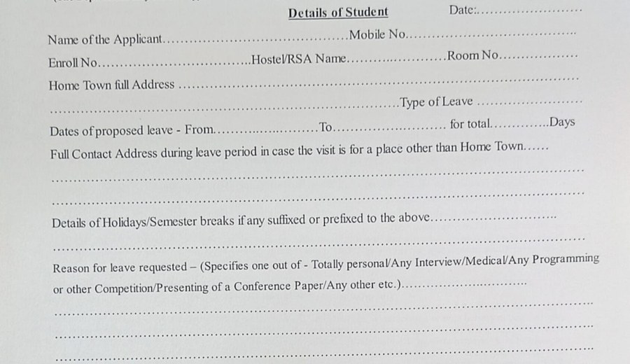

# Form fields

[← Equations](equations.md) · [All content types](../../README.md#content-types) · [Stamps and seals →](stamps-and-seals.md)

*Example region for form fields, as shown around the hub in paper Fig. 2.* Form fields is one of the six **content elements** (each occupies a region of the page) in the survey's content-type grouping (paper Sec. 2.2).

## Description (paper Sec. 2.2, word for word)

**Form fields** are key–value pairs bound by position rather than reading order. Datasets set the task across languages [[11]](https://arxiv.org/abs/1905.13538), [[12]](https://doi.org/10.18653/v1/2022.findings-acl.253), structural encoders bound keys to values [[81]](https://arxiv.org/abs/2203.08411), [[39]](https://doi.org/10.18653/v1/2023.acl-long.501), language models extracted fields with little or no training data [[82]](https://arxiv.org/abs/2309.10952), and benchmarks tested unseen templates and complex layouts [[83]](https://doi.org/10.1145/3580305.3599929), [[84]](https://aclanthology.org/2026.acl-long.287/).

## Coverage in the content-type × paradigm matrix (paper Table 7)

|OCR → LLM|MLLM-native|Text RAG|Visual RAG|
|:-:|:-:|:-:|:-:|
|✓|✓|✓|✓|

✓ results reported; ○ the type has an established task but no method in that column reports on it; ✗ nothing reported.

## Benchmarks of paper Table 9 that annotate it

- [FUNSD](https://arxiv.org/abs/1905.13538) (ICDARW 2019) · [link](https://guillaumejaume.github.io/FUNSD/)
- [VRDU](https://doi.org/10.1145/3580305.3599929) (KDD 2023) · [link](https://github.com/google-research-datasets/vrdu)

## Benchmarks of paper Table 9 where it is present but not annotated

- [ViDoRe V1](https://openreview.net/forum?id=ogjBpZ8uSi) (ICLR 2025)
- [ViDoRe V2](https://arxiv.org/abs/2505.17166) (arXiv 2025)
- [ViDoRe V3](https://aclanthology.org/2026.acl-long.755/) (ACL 2026)
- [MMDocIR](https://aclanthology.org/2025.emnlp-main.1576/) (EMNLP 2025)
- [MMDocRAG](https://papers.nips.cc/paper_files/paper/2025/hash/1a93178950e92fd2e7b7448f7d68fd7d-Abstract-Datasets_and_Benchmarks_Track.html) (NeurIPS 2025)
- [M3DocVQA](https://openaccess.thecvf.com/content/ICCV2025W/Findings/html/Cho_M3DocVQA_Multi-modal_Multi-page_Multi-document_Understanding_ICCVW_2025_paper.html) (ICCVW 2025)
- [ViDoSeek](https://aclanthology.org/2025.emnlp-main.464/) (EMNLP 2025)
- [UniDoc-Bench](https://arxiv.org/abs/2510.03663) (arXiv 2025)
- [SciEGQA](https://yuwenhan07.github.io/SciEGQA-project/) (arXiv 2026)
- [DocVQA](https://doi.org/10.1109/WACV48630.2021.00225) (WACV 2021)
- [LongDocURL](https://aclanthology.org/2025.acl-long.57/) (ACL 2025)
- [MTVQA](https://aclanthology.org/2025.findings-acl.404/) (ACL Find. 2025)

## Works the paper cites for it

|No.|Paper|Venue|Year|
|--:|---|---|:-:|
|[11]|[FUNSD: A Dataset for Form Understanding in Noisy Scanned Documents](https://arxiv.org/abs/1905.13538)|Proc. ICDAR Workshops|2019|
|[12]|[XFUND: A Benchmark Dataset for Multilingual Visually Rich Form Understanding](https://doi.org/10.18653/v1/2022.findings-acl.253)|Findings ACL|2022|
|[81]|[FormNet: Structural Encoding beyond Sequential Modeling in Form Document Information Extraction](https://arxiv.org/abs/2203.08411)|Proc. ACL|2022|
|[39]|[FormNetV2: Multimodal Graph Contrastive Learning for Form Document Information Extraction](https://doi.org/10.18653/v1/2023.acl-long.501)|Proc. ACL|2023|
|[82]|[LMDX: Language Model-based Document Information Extraction and Localization](https://arxiv.org/abs/2309.10952)|Findings ACL|2024|
|[83]|[VRDU: A Benchmark for Visually-rich Document Understanding](https://doi.org/10.1145/3580305.3599929)|Proc. KDD|2023|
|[84]|[UNIKIE-BENCH: Benchmarking Large Multimodal Models for Key Information Extraction in Visual Documents](https://aclanthology.org/2026.acl-long.287/)|Proc. ACL|2026|

[Back to README](../../README.md#content-types)
