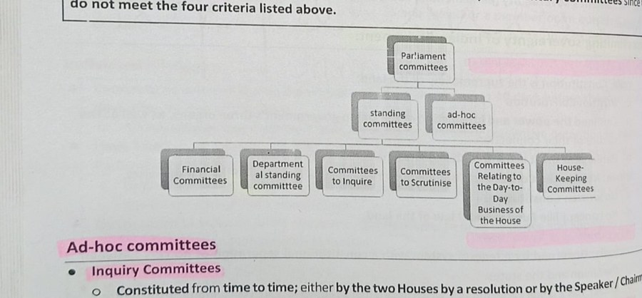

# Layout

[← Stamps and seals](stamps-and-seals.md) · [All content types](../../README.md#content-types) · [Typography →](typography.md)

*Example region for layout, as shown around the hub in paper Fig. 2.* Layout is one of the two **page-level properties** (not a region, but a property that every element has) in the survey's content-type grouping (paper Sec. 2.2).

## Description (paper Sec. 2.2, word for word)

**Layout** covers columns, blocks, captions, reading order and containment, and is *relational*: a block means something through its neighbors. Geometric decomposition [[25]](https://doi.org/10.1109/34.244677), [[26]](https://doi.org/10.1006/cviu.1998.0684) gave way to detection on large corpora [[16]](https://arxiv.org/abs/1908.07836), [[23]](https://doi.org/10.1145/3534678.3539043), reading order and hierarchy became learnable [[90]](https://doi.org/10.18653/v1/2021.emnlp-main.389), [[91]](https://openreview.net/forum?id=Fu0aggezN9), and layout is now injected into language models as tokens, positions or supervision [[92]](https://aclanthology.org/2025.findings-acl.379/), [[93]](https://openaccess.thecvf.com/content/CVPR2025/html/Zhu_A_Simple_yet_Effective_Layout_Token_in_Large_Language_Models_CVPR_2025_paper.html), [[94]](https://openaccess.thecvf.com/content/CVPR2025/html/Liao_DocLayLLM_An_Efficient_Multi-modal_Extension_of_Large_Language_Models_for_CVPR_2025_paper.html).

## Coverage in the content-type × paradigm matrix (paper Table 7)

|OCR → LLM|MLLM-native|Text RAG|Visual RAG|
|:-:|:-:|:-:|:-:|
|✓|✓|✓|✓|

✓ results reported; ○ the type has an established task but no method in that column reports on it; ✗ nothing reported.

## Benchmarks of paper Table 9 that annotate it

- [ViDoRe V3](https://aclanthology.org/2026.acl-long.755/) (ACL 2026) · [link](https://arxiv.org/pdf/2601.08620)
- [MMDocIR](https://aclanthology.org/2025.emnlp-main.1576/) (EMNLP 2025) · [link](https://huggingface.co/MMDocIR)
- [UniDoc-Bench](https://arxiv.org/abs/2510.03663) (arXiv 2025) · [link](https://github.com/SalesforceAIResearch/UniDOC-Bench)
- [SciEGQA](https://yuwenhan07.github.io/SciEGQA-project/) (arXiv 2026) · [link](https://yuwenhan07.github.io/SciEGQA-project/)
- [InfographicVQA](https://arxiv.org/abs/2104.12756) (WACV 2022) · [link](https://arxiv.org/pdf/2104.12756)
- [LongDocURL](https://aclanthology.org/2025.acl-long.57/) (ACL 2025) · [link](https://github.com/dengc2023/LongDocURL)
- [DocLayNet](https://doi.org/10.1145/3534678.3539043) (KDD 2022) · [link](https://github.com/DS4SD/DocLayNet)

## Benchmarks of paper Table 9 where it is present but not annotated

- [ViDoRe V1](https://openreview.net/forum?id=ogjBpZ8uSi) (ICLR 2025)
- [ViDoRe V2](https://arxiv.org/abs/2505.17166) (arXiv 2025)
- [MMDocRAG](https://papers.nips.cc/paper_files/paper/2025/hash/1a93178950e92fd2e7b7448f7d68fd7d-Abstract-Datasets_and_Benchmarks_Track.html) (NeurIPS 2025)
- [M3DocVQA](https://openaccess.thecvf.com/content/ICCV2025W/Findings/html/Cho_M3DocVQA_Multi-modal_Multi-page_Multi-document_Understanding_ICCVW_2025_paper.html) (ICCVW 2025)
- [ViDoSeek](https://aclanthology.org/2025.emnlp-main.464/) (EMNLP 2025)
- [DocVQA](https://doi.org/10.1109/WACV48630.2021.00225) (WACV 2021)
- [TAT-DQA](https://arxiv.org/abs/2207.11871) (ACM MM 2022)
- [SPIQA](https://arxiv.org/abs/2407.09413) (NeurIPS 2024)
- [MTVQA](https://aclanthology.org/2025.findings-acl.404/) (ACL Find. 2025)
- [FUNSD](https://arxiv.org/abs/1905.13538) (ICDARW 2019)
- [VRDU](https://doi.org/10.1145/3580305.3599929) (KDD 2023)
- [PubTables-1M](https://arxiv.org/abs/2110.00061) (CVPR 2022)
- [SPODS](https://doi.org/10.1007/978-3-319-68124-5_19) (ICVGIP-W 2017)
- [DKDS](https://doi.org/10.1007/s10032-026-00595-5) (IJDAR 2026)
- [TexTAR](https://doi.org/10.1007/978-3-032-04614-7_16) (ICDAR 2025)

## Works the paper cites for it

|No.|Paper|Venue|Year|
|--:|---|---|:-:|
|[25]|[The Document Spectrum for Page Layout Analysis](https://doi.org/10.1109/34.244677)|IEEE Trans. Pattern Anal. Mach. Intell.|1993|
|[26]|[Segmentation of Page Images Using the Area Voronoi Diagram](https://doi.org/10.1006/cviu.1998.0684)|Comput. Vis. Image Underst.|1998|
|[16]|[PubLayNet: Largest Dataset Ever for Document Layout Analysis](https://arxiv.org/abs/1908.07836)|Proc. ICDAR|2019|
|[23]|[DocLayNet: A Large Human-Annotated Dataset for Document-Layout Segmentation](https://doi.org/10.1145/3534678.3539043)|Proc. KDD|2022|
|[90]|[LayoutReader: Pre-training of Text and Layout for Reading Order Detection](https://doi.org/10.18653/v1/2021.emnlp-main.389)|Proc. EMNLP|2021|
|[91]|[Graph-based Document Structure Analysis](https://openreview.net/forum?id=Fu0aggezN9)|Proc. ICLR|2025|
|[92]|[A Bounding Box is Worth One Token: Interleaving Layout and Text in a Large Language Model for Document Understanding](https://aclanthology.org/2025.findings-acl.379/)|Findings ACL|2025|
|[93]|[A Simple yet Effective Layout Token in Large Language Models for Document Understanding](https://openaccess.thecvf.com/content/CVPR2025/html/Zhu_A_Simple_yet_Effective_Layout_Token_in_Large_Language_Models_CVPR_2025_paper.html)|Proc. CVPR|2025|
|[94]|[DocLayLLM: An Efficient Multi-modal Extension of Large Language Models for Text-rich Document Understanding](https://openaccess.thecvf.com/content/CVPR2025/html/Liao_DocLayLLM_An_Efficient_Multi-modal_Extension_of_Large_Language_Models_for_CVPR_2025_paper.html)|Proc. CVPR|2025|

[Back to README](../../README.md#content-types)
