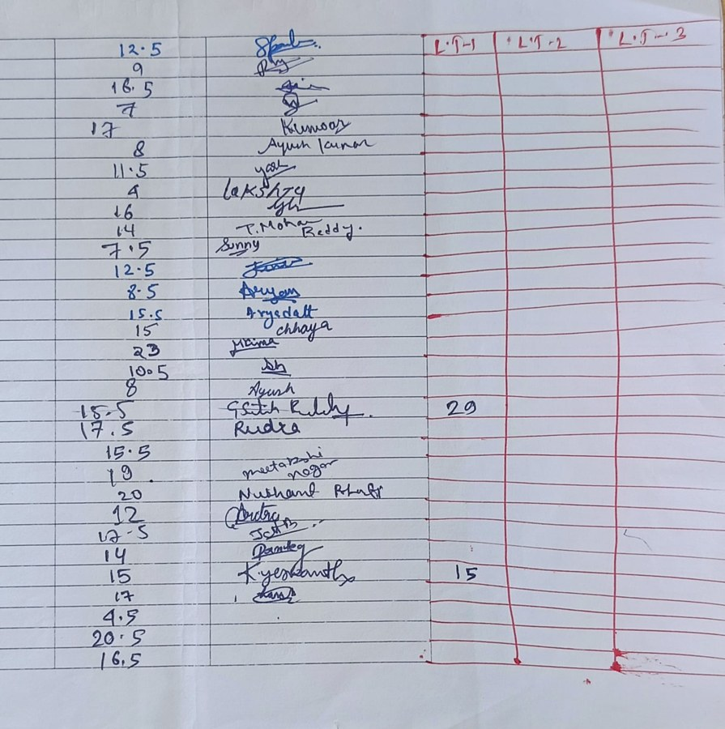

# Tables

[← Running text](running-text.md) · [All content types](../../README.md#content-types) · [Figures and charts →](figures-and-charts.md)

*Example region for tables, as shown around the hub in paper Fig. 2.* Tables is one of the six **content elements** (each occupies a region of the page) in the survey's content-type grouping (paper Sec. 2.2).

## Description (paper Sec. 2.2, word for word)

**Tables** are grids in which a cell's position carries meaning, marked by rules or white space that are often absent. Two surveys twenty years apart bracket the topic [[27]](https://doi.org/10.1007/s10032-004-0120-9), [[48]](https://doi.org/10.1145/3657281); structure recognition grew on large corpora [[15]](https://arxiv.org/abs/2110.00061), from end-to-end decoding [[14]](https://arxiv.org/abs/2203.01017) to compact tokenizations [[37]](https://arxiv.org/abs/2305.03393) and logical-location regression [[38]](https://doi.org/10.1016/j.patcog.2024.110816), and multimodal models now reason over table images directly [[71]](https://arxiv.org/abs/2406.08100). Li *et al.* [[72]](https://doi.org/10.1016/j.patcog.2022.108946) treat table structure and form parsing as one relation-parsing problem, a sign of how close the two types are.

## Coverage in the content-type × paradigm matrix (paper Table 7)

|OCR → LLM|MLLM-native|Text RAG|Visual RAG|
|:-:|:-:|:-:|:-:|
|✓|✓|✓|✓|

✓ results reported; ○ the type has an established task but no method in that column reports on it; ✗ nothing reported.

## Benchmarks of paper Table 9 that annotate it

- [ViDoRe V3](https://aclanthology.org/2026.acl-long.755/) (ACL 2026) · [link](https://arxiv.org/pdf/2601.08620)
- [MMDocIR](https://aclanthology.org/2025.emnlp-main.1576/) (EMNLP 2025) · [link](https://huggingface.co/MMDocIR)
- [MMDocRAG](https://papers.nips.cc/paper_files/paper/2025/hash/1a93178950e92fd2e7b7448f7d68fd7d-Abstract-Datasets_and_Benchmarks_Track.html) (NeurIPS 2025) · [link](https://github.com/MMDocRAG/MMDocRAG)
- [UniDoc-Bench](https://arxiv.org/abs/2510.03663) (arXiv 2025) · [link](https://github.com/SalesforceAIResearch/UniDOC-Bench)
- [TAT-DQA](https://arxiv.org/abs/2207.11871) (ACM MM 2022) · [link](https://github.com/NExTplusplus/TAT-DQA)
- [SPIQA](https://arxiv.org/abs/2407.09413) (NeurIPS 2024) · [link](https://arxiv.org/pdf/2407.09413)
- [LongDocURL](https://aclanthology.org/2025.acl-long.57/) (ACL 2025) · [link](https://github.com/dengc2023/LongDocURL)
- [DocLayNet](https://doi.org/10.1145/3534678.3539043) (KDD 2022) · [link](https://github.com/DS4SD/DocLayNet)
- [PubTables-1M](https://arxiv.org/abs/2110.00061) (CVPR 2022) · [link](https://github.com/microsoft/table-transformer)

## Benchmarks of paper Table 9 where it is present but not annotated

- [ViDoRe V1](https://openreview.net/forum?id=ogjBpZ8uSi) (ICLR 2025)
- [ViDoRe V2](https://arxiv.org/abs/2505.17166) (arXiv 2025)
- [M3DocVQA](https://openaccess.thecvf.com/content/ICCV2025W/Findings/html/Cho_M3DocVQA_Multi-modal_Multi-page_Multi-document_Understanding_ICCVW_2025_paper.html) (ICCVW 2025)
- [ViDoSeek](https://aclanthology.org/2025.emnlp-main.464/) (EMNLP 2025)
- [SciEGQA](https://yuwenhan07.github.io/SciEGQA-project/) (arXiv 2026)
- [DocVQA](https://doi.org/10.1109/WACV48630.2021.00225) (WACV 2021)
- [InfographicVQA](https://arxiv.org/abs/2104.12756) (WACV 2022)
- [MTVQA](https://aclanthology.org/2025.findings-acl.404/) (ACL Find. 2025)

## Works the paper cites for it

|No.|Paper|Venue|Year|
|--:|---|---|:-:|
|[27]|[A Survey of Table Recognition: Models, Observations, Transformations, and Inferences](https://doi.org/10.1007/s10032-004-0120-9)|Int. J. Doc. Anal. Recognit.|2004|
|[48]|[Deep Learning for Table Detection and Structure Recognition: A Survey](https://doi.org/10.1145/3657281)|ACM Comput. Surv.|2024|
|[15]|[PubTables-1M: Towards Comprehensive Table Extraction from Unstructured Documents](https://arxiv.org/abs/2110.00061)|Proc. CVPR|2022|
|[14]|[TableFormer: Table Structure Understanding with Transformers](https://arxiv.org/abs/2203.01017)|Proc. CVPR|2022|
|[37]|[Optimized Table Tokenization for Table Structure Recognition](https://arxiv.org/abs/2305.03393)|Proc. ICDAR|2023|
|[38]|[LORE++: Logical Location Regression Network for Table Structure Recognition with Pre-training](https://doi.org/10.1016/j.patcog.2024.110816)|Pattern Recognit.|2025|
|[71]|[Multimodal Table Understanding](https://arxiv.org/abs/2406.08100)|Proc. ACL|2024|
|[72]|[Table Structure Recognition and Form Parsing by End-to-End Object Detection and Relation Parsing](https://doi.org/10.1016/j.patcog.2022.108946)|Pattern Recognit.|2022|

[Back to README](../../README.md#content-types)
