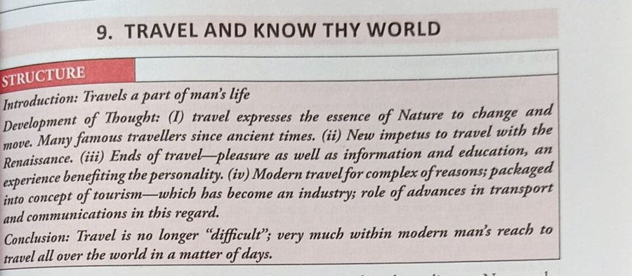

# Typography

[← Layout](layout.md) · [All content types](../../README.md#content-types)

*Example region for typography, as shown around the hub in paper Fig. 2.* Typography is one of the two **page-level properties** (not a region, but a property that every element has) in the survey's content-type grouping (paper Sec. 2.2).

## Description (paper Sec. 2.2, word for word)

**Typography** (typeface, weight and emphasis) changes what text signals without changing its characters, so transcription is blind to it. Font recognition began with typographical features [[30]](https://www.semanticscholar.org/paper/Optical-Font-Recognition-Using-Typographical-Zramdini-Ingold/2097d07a289e65c4d676a502756726b75f24af80), but vision venues now mostly *generate* fonts [[44]](https://arxiv.org/abs/2312.12142); reading typography survives in historical documents [[95]](https://doi.org/10.1007/978-3-030-86337-1_41) and in TexTAR [[96]](https://doi.org/10.1007/978-3-032-04614-7_16), the only word-level annotation of bold, italic, underline and strike-out we found.

## Coverage in the content-type × paradigm matrix (paper Table 7)

|OCR → LLM|MLLM-native|Text RAG|Visual RAG|
|:-:|:-:|:-:|:-:|
|✗|✗|✗|✗|

✓ results reported; ○ the type has an established task but no method in that column reports on it; ✗ nothing reported.

## Benchmarks of paper Table 9 that annotate it

- [TexTAR](https://doi.org/10.1007/978-3-032-04614-7_16) (ICDAR 2025) · [link](https://arxiv.org/pdf/2509.13151)

## Benchmarks of paper Table 9 where it is present but not annotated

- none

## Works the paper cites for it

|No.|Paper|Venue|Year|
|--:|---|---|:-:|
|[30]|[Optical Font Recognition Using Typographical Features](https://www.semanticscholar.org/paper/Optical-Font-Recognition-Using-Typographical-Zramdini-Ingold/2097d07a289e65c4d676a502756726b75f24af80)|IEEE Trans. Pattern Anal. Mach. Intell.|1998|
|[44]|[FontDiffuser: One-Shot Font Generation via Denoising Diffusion with Multi-Scale Content Aggregation and Style Contrastive Learning](https://arxiv.org/abs/2312.12142)|Proc. AAAI|2024|
|[95]|[ICDAR 2021 Competition on Historical Document Classification](https://doi.org/10.1007/978-3-030-86337-1_41)|Proc. ICDAR|2021|
|[96]|[TexTAR: Textual Attribute Recognition in Multi-domain and Multi-lingual Document Images](https://doi.org/10.1007/978-3-032-04614-7_16)|Proc. ICDAR|2025|

[Back to README](../../README.md#content-types)
