# Figures and tables of the paper (HD)

Every figure and table of the final paper, rendered from the paper source at 300 dpi, with the paper's own captions and citation numbers ([numbered reference list](paper_references.md)). Click an image to open it at full size; the link under it opens the same content as a searchable, clickable page.

[Back to README](../README.md#paper-to-repository-map)

## Figures

[Fig. 1](#fig-1) · [Fig. 2](#fig-2) · [Fig. 3](#fig-3) · [Fig. 4](#fig-4) · [Fig. 5](#fig-5) · [Fig. 6](#fig-6) · [Fig. 7](#fig-7) · [Fig. 8](#fig-8) · [Fig. 9](#fig-9) · [Fig. 10](#fig-10) · [Fig. 11](#fig-11)

### Fig. 1

[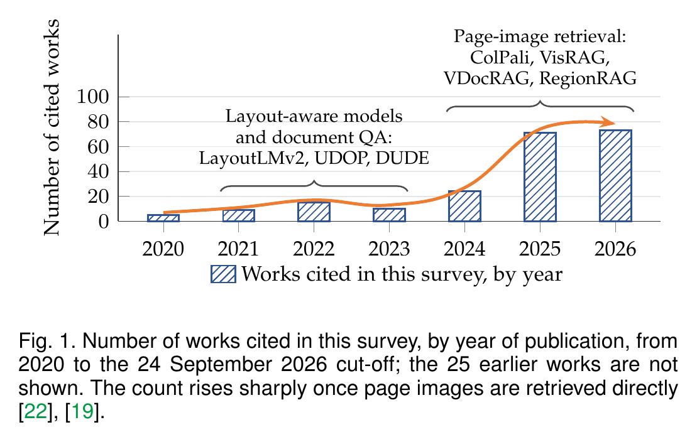](../images/fig01_pubs.png)

*Fig. 1. Number of works cited in this survey, by year of publication, from 2020 to the 24 September 2026 cut-off; the 25 earlier works are not shown. The count rises sharply once page images are retrieved directly [[22]](https://arxiv.org/abs/2406.11251), [[19]](https://openreview.net/forum?id=ogjBpZ8uSi).* [All works A-Z](all_works.md)

### Fig. 2

[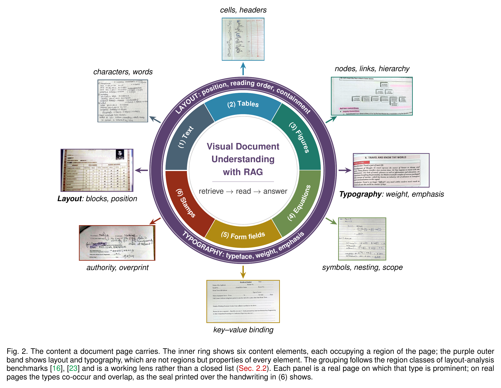](../images/fig02_hub.png)

*Fig. 2. The content a document page carries. The inner ring shows six content elements, each occupying a region of the page; the purple outer band shows layout and typography, which are not regions but properties of every element. The grouping follows the region classes of layout-analysis benchmarks [[16]](https://arxiv.org/abs/1908.07836), [[23]](https://doi.org/10.1145/3534678.3539043) and is a working lens rather than a closed list (Sec. 2.2). Each panel is a real page on which that type is prominent; on real pages the types co-occur and overlap, as the seal printed over the handwriting in (6) shows.* [Content types](../README.md#content-types)

### Fig. 3

[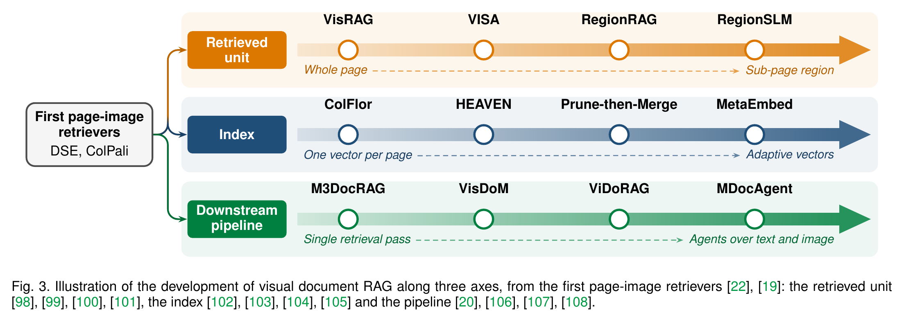](../images/fig03_development.png)

*Fig. 3. Illustration of the development of visual document RAG along three axes, from the first page-image retrievers [[22]](https://arxiv.org/abs/2406.11251), [[19]](https://openreview.net/forum?id=ogjBpZ8uSi): the retrieved unit [[98]](https://openreview.net/forum?id=zG459X3Xge), [[99]](https://aclanthology.org/2025.acl-long.1456/), [[100]](https://ojs.aaai.org/index.php/AAAI/article/view/37597), [[101]](https://doi.org/10.1145/3805712.3809603), the index [[102]](https://ieeexplore.ieee.org/document/11204231/), [[103]](https://aclanthology.org/2026.findings-acl.54/), [[104]](https://aclanthology.org/2026.findings-acl.1247/), [[105]](https://openreview.net/forum?id=yKDqg9HwZX) and the pipeline [[20]](https://openaccess.thecvf.com/content/ICCV2025W/Findings/html/Cho_M3DocVQA_Multi-modal_Multi-page_Multi-document_Understanding_ICCVW_2025_paper.html), [[106]](https://arxiv.org/abs/2412.10704), [[107]](https://aclanthology.org/2025.emnlp-main.464/), [[108]](https://arxiv.org/pdf/2503.13964).* [Methods](methods.md)

### Fig. 4

[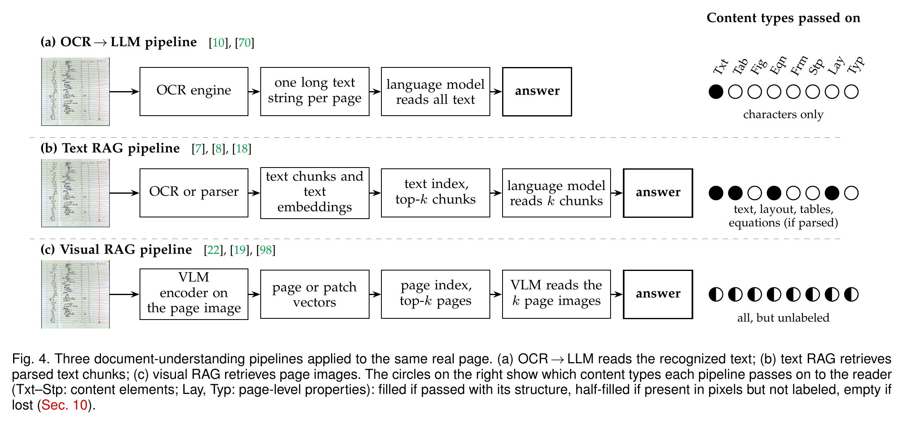](../images/fig04_pipelines.png)

*Fig. 4. Three document-understanding pipelines applied to the same real page. (a) OCR → LLM reads the recognized text; (b) text RAG retrieves parsed text chunks; (c) visual RAG retrieves page images. The circles on the right show which content types each pipeline passes on to the reader (Txt–Stp: content elements; Lay, Typ: page-level properties): filled if passed with its structure, half-filled if present in pixels but not labeled, empty if lost (Sec. 10).* [Encoders](encoders.md)

### Fig. 5

[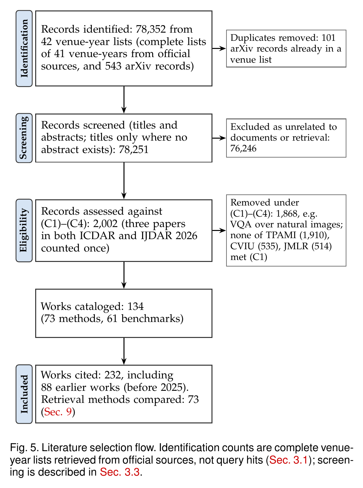](../images/fig05_prisma.png)

*Fig. 5. Literature selection flow. Identification counts are complete venue-year lists retrieved from official sources, not query hits (Sec. 3.1); screening is described in Sec. 3.3.* [Search and screening terms](search_terms.md) · [Venue lists](venues.md)

### Fig. 6

[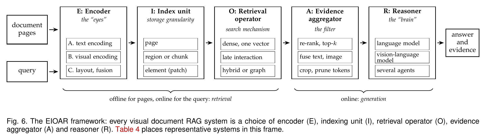](../images/fig06_eioar.png)

*Fig. 6. The EIOAR framework: every visual document RAG system is a choice of encoder (E), indexing unit (I), retrieval operator (O), evidence aggregator (A) and reasoner (R). Table 4 places representative systems in this frame.* [EIOAR table](../data/eioar.md)

### Fig. 7

[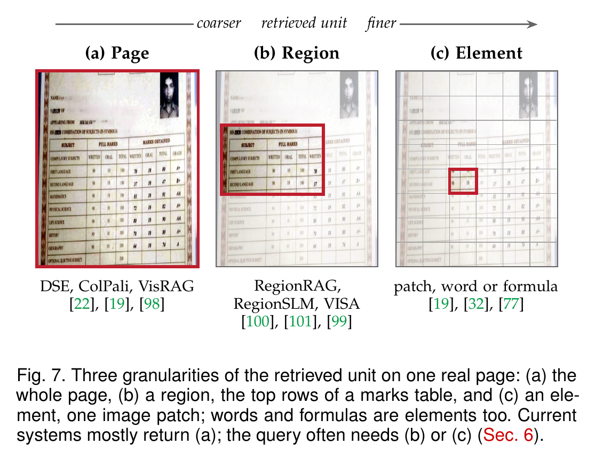](../images/fig07_granularity.png)

*Fig. 7. Three granularities of the retrieved unit on one real page: (a) the whole page, (b) a region, the top rows of a marks table, and (c) an element, one image patch; words and formulas are elements too. Current systems mostly return (a); the query often needs (b) or (c) (Sec. 6).* [Methods](methods.md)

### Fig. 8

[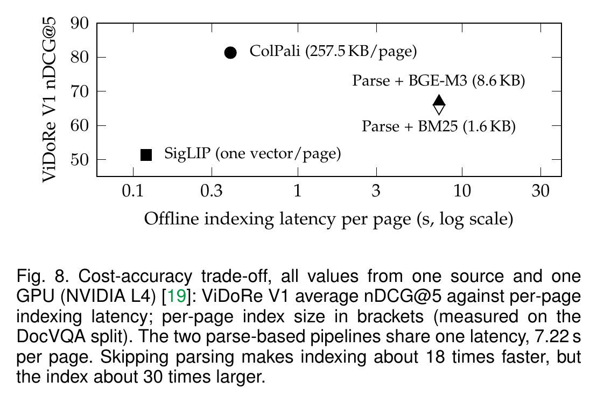](../images/fig08_cost.png)

*Fig. 8. Cost-accuracy trade-off, all values from one source and one GPU (NVIDIA L4) [[19]](https://openreview.net/forum?id=ogjBpZ8uSi): ViDoRe V1 average nDCG@5 against per-page indexing latency; per-page index size in brackets (measured on the DocVQA split). The two parse-based pipelines share one latency, 7.22 s per page. Skipping parsing makes indexing about 18 times faster, but the index about 30 times larger.* [Scores](scores.md)

### Fig. 9

[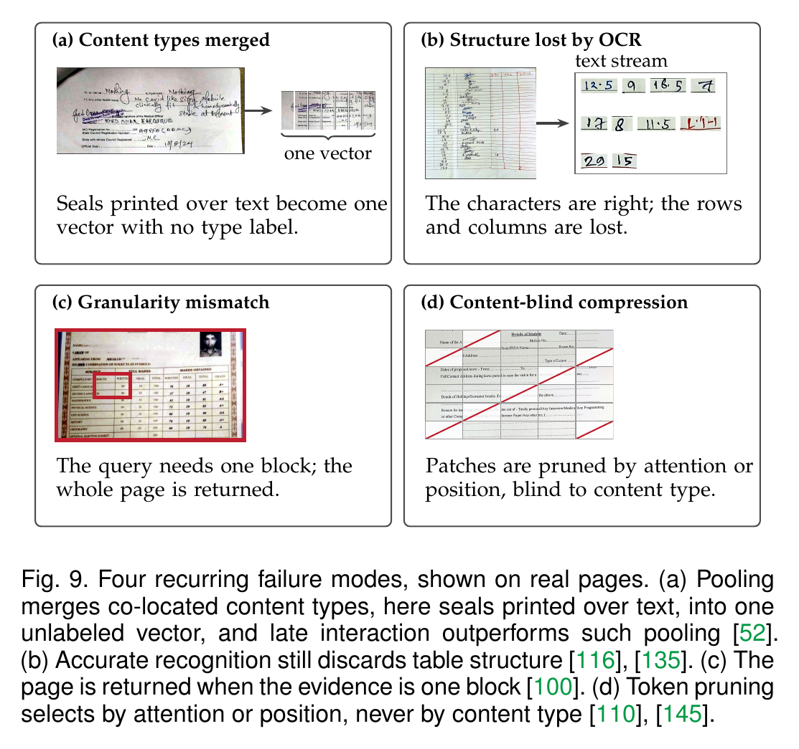](../images/fig09_failures.png)

*Fig. 9. Four recurring failure modes, shown on real pages. (a) Pooling merges co-located content types, here seals printed over text, into one unlabeled vector, and late interaction outperforms such pooling [[52]](https://doi.org/10.1145/3726302.3730285). (b) Accurate recognition still discards table structure [[116]](https://aclanthology.org/2026.acl-industry.60/), [[135]](https://openaccess.thecvf.com/content/ICCV2025/html/Zhang_OCR_Hinders_RAG_Evaluating_the_Cascading_Impact_of_OCR_on_ICCV_2025_paper.html). (c) The page is returned when the evidence is one block [[100]](https://ojs.aaai.org/index.php/AAAI/article/view/37597). (d) Token pruning selects by attention or position, never by content type [[110]](https://arxiv.org/abs/2509.23883), [[145]](https://arxiv.org/abs/2601.20107).* [Encoders](encoders.md)

### Fig. 10

*Fig. 10. The seven VDU-RAG application areas of Sec. 13, with representative systems and benchmarks and, in italics, the content types each depends on most.* [Applications](applications.md)

### Fig. 11

[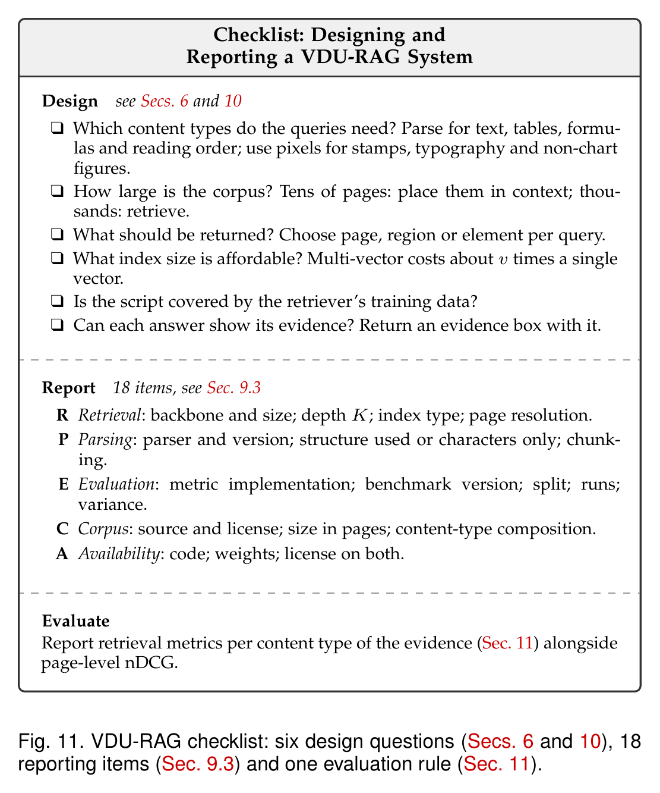](../images/fig11_checklist.png)

*Fig. 11. VDU-RAG checklist: six design questions (Secs. 6 and 10), 18 reporting items (Sec. 9.3) and one evaluation rule (Sec. 11).* [Checklist](checklist.md)

## Tables

[Table 1](#table-1) · [Table 2](#table-2) · [Table 3](#table-3) · [Table 4](#table-4) · [Table 5](#table-5) · [Table 6](#table-6) · [Table 7](#table-7) · [Table 8](#table-8) · [Table 9](#table-9)

### Table 1

[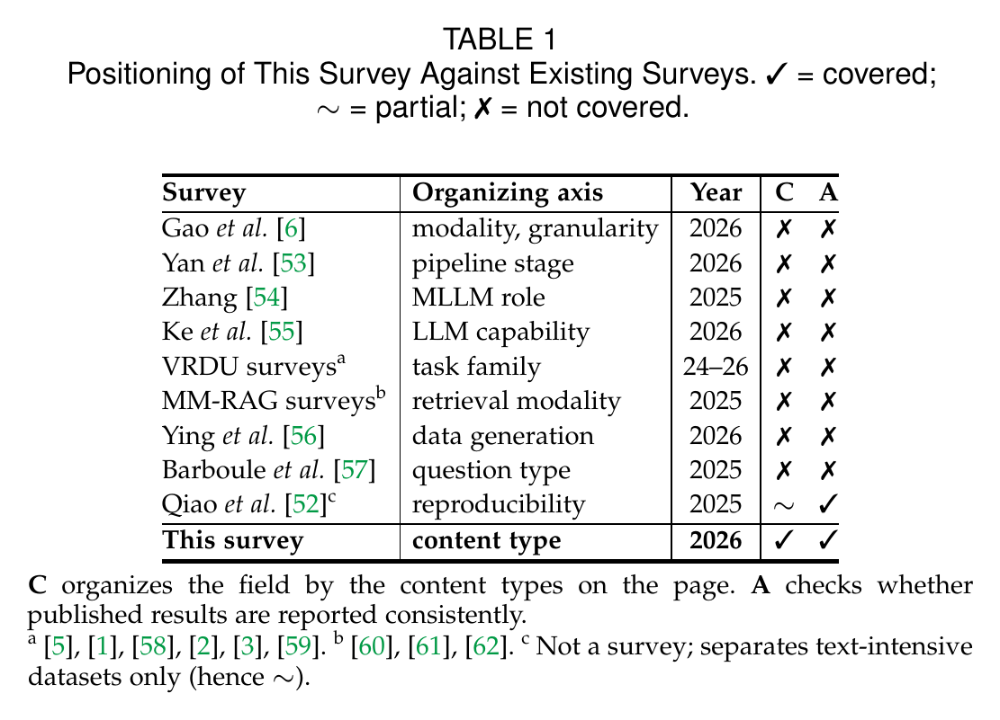](../images/tables/tab01_surveys.png)

*Table 1. Positioning of This Survey Against Existing Surveys. 51 = covered; ∼ = partial; 55 = not covered.* [Related surveys](related_surveys.md)

### Table 2

[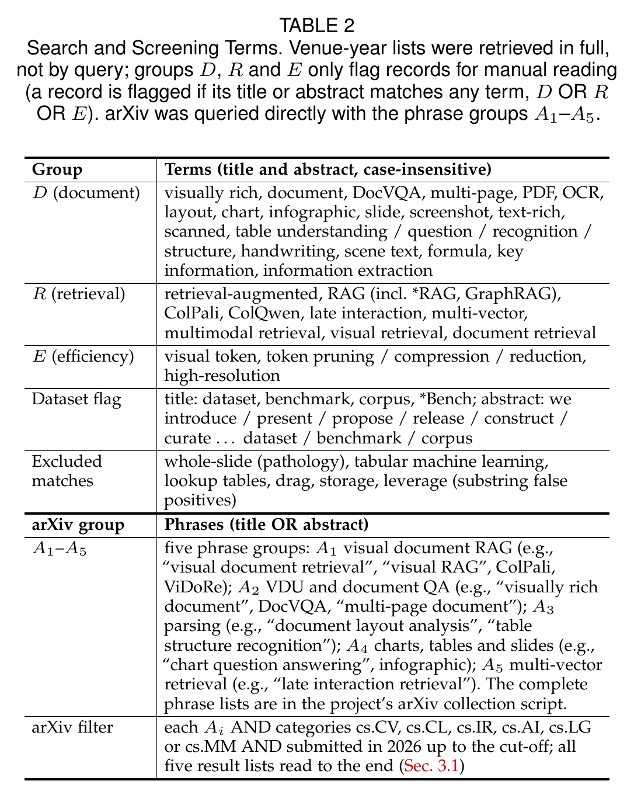](../images/tables/tab02_queries.png)

*Table 2. Search and Screening Terms. Venue-year lists were retrieved in full, not by query; groups D, R and E only flag records for manual reading (a record is flagged if its title or abstract matches any term, D OR R OR E). arXiv was queried directly with the phrase groups A1–A5.* [Search terms](search_terms.md)

### Table 3

[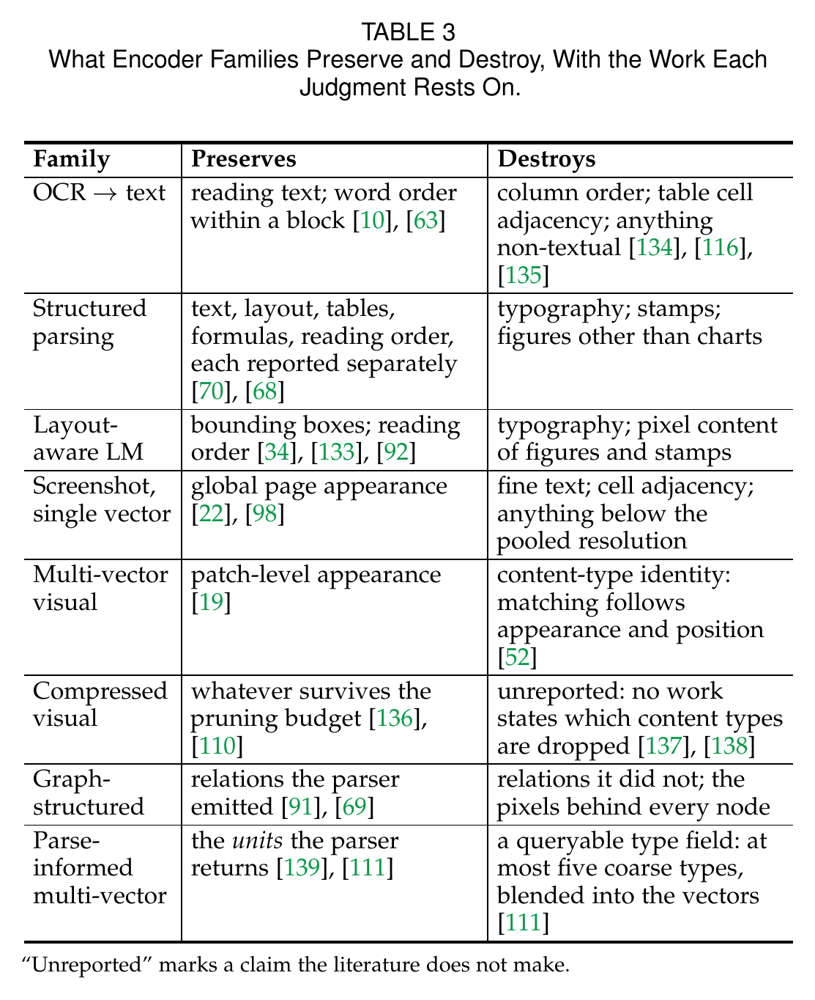](../images/tables/tab03_encoding.png)

*Table 3. What Encoder Families Preserve and Destroy, With the Work Each Judgment Rests On.* [Encoders](encoders.md)

### Table 4

[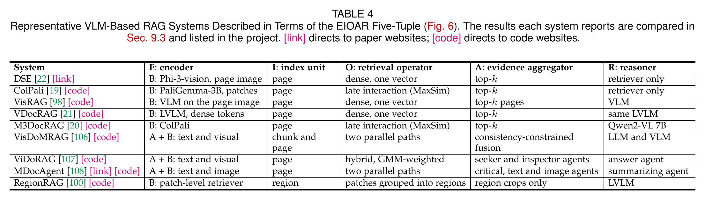](../images/tables/tab04_eioar.png)

*Table 4. Representative VLM-Based RAG Systems Described in Terms of the EIOAR Five-Tuple (Fig. 6). The results each system reports are compared in Sec. 9.3 and listed in the project. [link] directs to paper websites; [code] directs to code websites.* [EIOAR table](../data/eioar.md)

### Table 5

[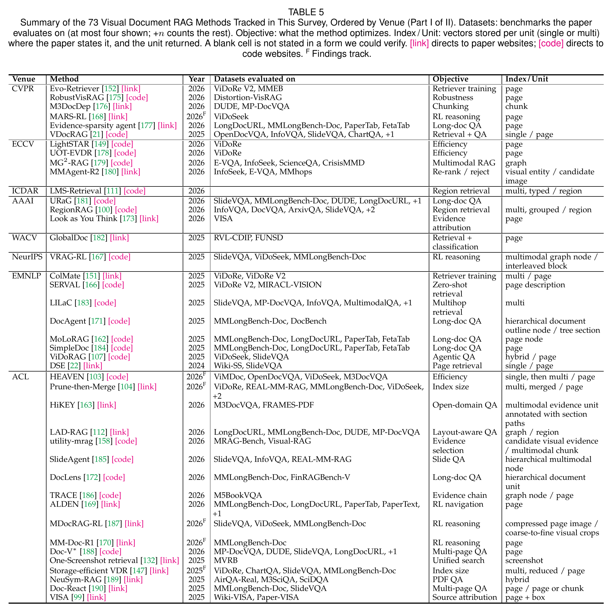](../images/tables/tab05_methods_part1.png)

*Table 5. Summary of the 73 Visual Document RAG Methods Tracked in This Survey, Ordered by Venue (Part I of II). Datasets: benchmarks the paper evaluates on (at most four shown; +n counts the rest). Objective: what the method optimizes. Index / Unit: vectors stored per unit (single or multi) where the paper states it, and the unit returned. A blank cell is not stated in a form we could verify. [link] directs to paper websites; [code] directs to code websites. (F) Findings track.* [Methods](methods.md)

### Table 6

[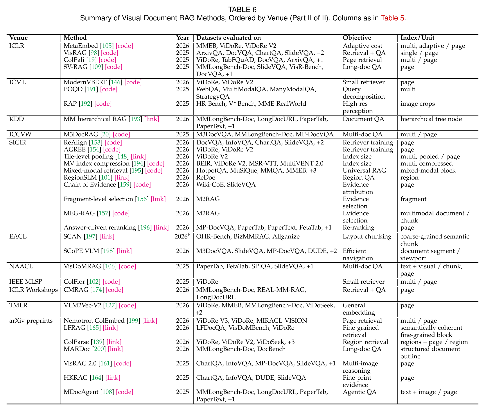](../images/tables/tab06_methods_part2.png)

*Table 6. Summary of Visual Document RAG Methods, Ordered by Venue (Part II of II). Columns as in Table 5.* [Methods](methods.md)

### Table 7

[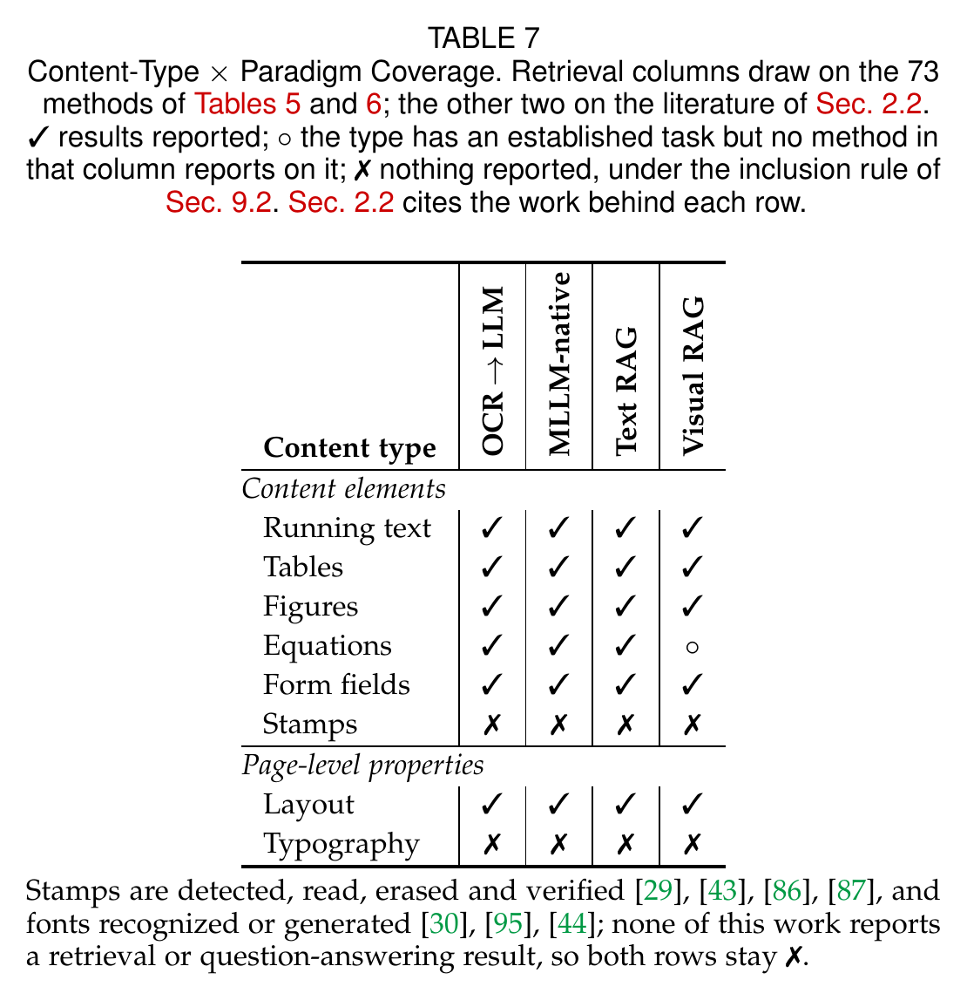](../images/tables/tab07_matrix.png)

*Table 7. Content-Type × Paradigm Coverage. Retrieval columns draw on the 73 methods of Tables 5 and 6; the other two on the literature of Sec. 2.2. ✓ results reported; ○ the type has an established task but no method in that column reports on it; ✗ nothing reported, under the inclusion rule of Sec. 9.2. Sec. 2.2 cites the work behind each row.* [Content types](../README.md#content-types)

### Table 8

[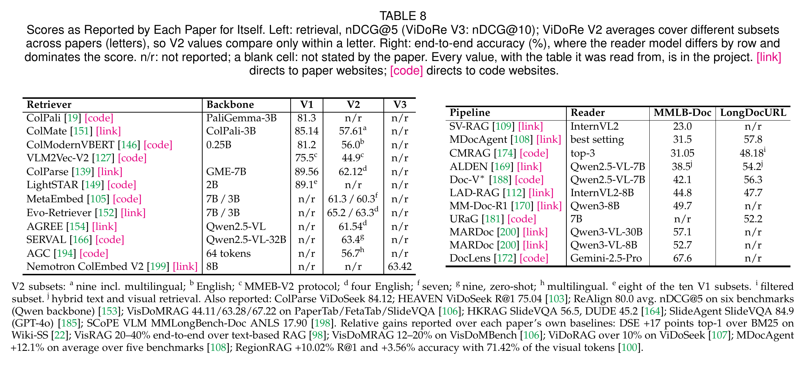](../images/tables/tab08_scores.png)

*Table 8. Scores as Reported by Each Paper for Itself. Left: retrieval, nDCG@5 (ViDoRe V3: nDCG@10); ViDoRe V2 averages cover different subsets across papers (letters), so V2 values compare only within a letter. Right: end-to-end accuracy (%), where the reader model differs by row and dominates the score. n/r: not reported; a blank cell: not stated by the paper. Every value, with the table it was read from, is in the project. [link] directs to paper websites; [code] directs to code websites.* [Scores](scores.md)

### Table 9

[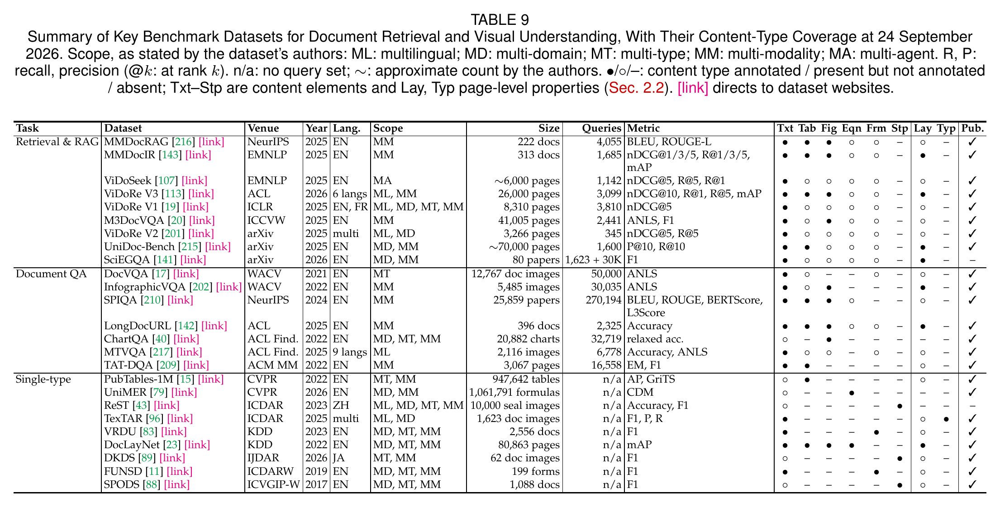](../images/tables/tab09_datasets.png)

*Table 9. Summary of Key Benchmark Datasets for Document Retrieval and Visual Understanding, With Their Content-Type Coverage at 24 September 2026. Scope, as stated by the dataset's authors: ML: multilingual; MD: multi-domain; MT: multi-type; MM: multi-modality; MA: multi-agent. R, P: recall, precision (@k: at rank k). n/a: no query set; ∼: approximate count by the authors. •/◦/–: content type annotated / present but not annotated / absent; Txt–Stp are content elements and Lay, Typ page-level properties (Sec. 2.2). [link] directs to dataset websites.* [Datasets](datasets.md)
